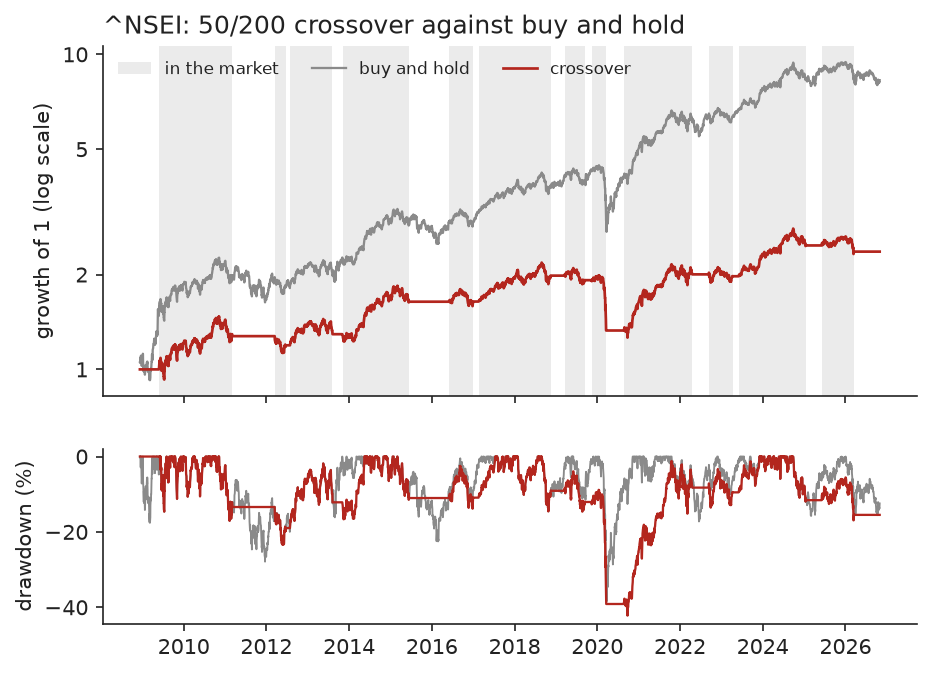
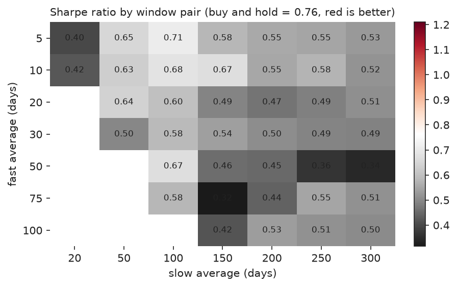
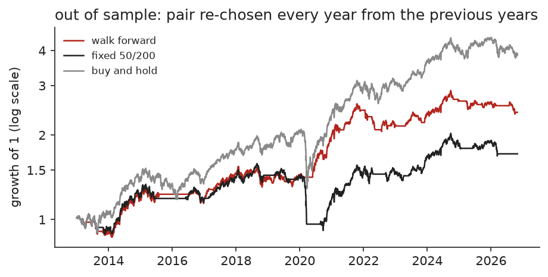

# ma-crossover-backtest

A backtest of the simplest trend rule there is: hold the asset when its fast moving average
is above its slow one, hold cash otherwise. The rule takes ten lines. The rest of the repo
checks whether the result can be trusted: trading costs, execution delay, 40 window pairs
instead of one, walk-forward selection, and bootstrap tests against buy and hold.

Tested on the Nifty 50 index, daily closes from 2007-09-17 to 2026-10-30, and on eight
large NSE stocks. Full output in [results/report.md](results/report.md).

## Result

The rule does not beat buy and hold on the Nifty. Results from 2008-12-10, 10 basis points
per trade, cash earns nothing:

| | return / yr | vol / yr | Sharpe | max drawdown |
|---|---|---|---|---|
| crossover 50/200 | 5.1% | 12.9% | 0.45 | 42.2% |
| buy and hold | 12.9% | 18.0% | 0.76 | 38.4% |



- The 50/200 rule made 12 round trips in 18 years, 7 of them profitable, and was in the
  market 70% of the time. It lowered volatility but not the worst drawdown: in March 2020
  it was still long through the fall, sold near the bottom and bought back months later.
  That one trade lost 30.7%.
- None of the 40 window pairs has a higher Sharpe ratio than buy and hold (0.76). The best
  in hindsight, 5/100, reaches 0.71. White's reality check gives p = 1.000, so there is
  nothing to explain away.
- Walk forward (each year trade the pair that had the best Sharpe over the previous five
  years) gives 6.7% a year with Sharpe 0.65 and a 20.4% maximum drawdown over 2013 to 2026,
  against 10.6%, 0.71 and 38.4% for buy and hold. The Sharpe difference is -0.06 with a
  95% bootstrap interval of -0.53 to +0.41, so the two cannot be told apart on risk
  adjusted return. The drawdown is about half.
- Costs are not the problem. With no costs the 50/200 return is 5.2% a year, with 25 basis
  points 4.8%. Paying 6% on cash lifts it to 6.9%.
- On nine assets the 50/200 rule has a higher Sharpe ratio than buy and hold on two (ITC,
  Sun Pharma) and a smaller maximum drawdown on six.





## How the backtest avoids fooling itself

- The position on a day uses the signal from the previous close. A `lag` below 1 raises an
  error. A test changes future prices and checks that earlier positions and returns do not
  move.
- Every window pair is scored on the same days, starting after the longest window (300
  days) has warmed up.
- Costs are charged on every switch in and out.
- The walk-forward pick for a year uses only earlier years. A test changes the last year
  and checks that no earlier pick moves.
- Sharpe differences come with a stationary bootstrap interval (mean block 20 days), and
  the best of the grid is tested with White's reality check, which accounts for having
  tried 40 rules on the same data.

## Run it

```
uv venv && uv pip install -e ".[dev]"
.venv/bin/python -m macross config.toml     # writes results/report.md and figures
.venv/bin/python -m pytest
```

`config.toml` sets the asset (any Yahoo Finance symbol), the window pair, the grid, costs,
cash rate and bootstrap settings. Prices are downloaded once with yfinance and cached in
`data/`.

## Limits

- Yahoo's Nifty history starts in September 2007 and 300 days go to warm-up, so the test
  starts in December 2008, after the 2008 fall. That is the kind of market where a trend
  rule helps most, and it is not in the sample.
- The Nifty series is a price index without dividends, which understates buy and hold a
  little and the strategy by less.
- Long or cash only. No short side, no position sizing, no taxes.
- The eight stocks are large companies that exist today, so that table has survivorship
  bias in favour of buy and hold.

## References

- Brock, Lakonishok and LeBaron (1992), Simple technical trading rules and the stochastic properties of stock returns.
- White (2000), A reality check for data snooping.
- Politis and Romano (1994), The stationary bootstrap.
