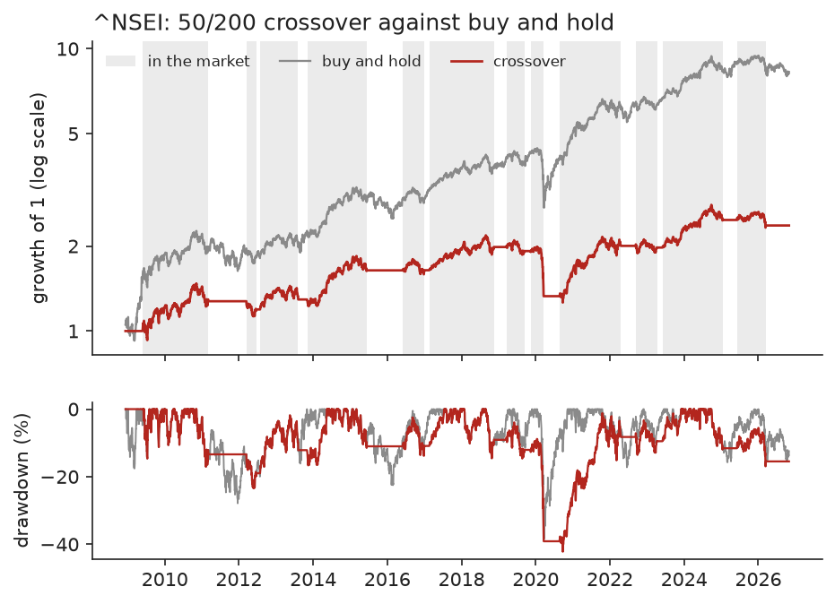
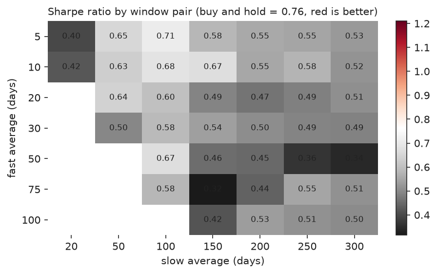
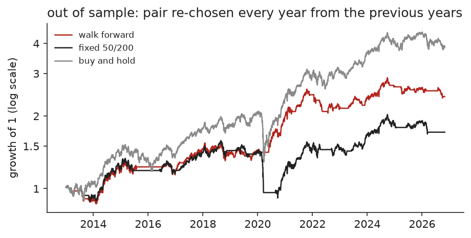

# Moving average crossover on ^NSEI

Long when the 50-day average is above the 200-day average, otherwise in cash at 0.0%. Signal at the close, trade at that close, 10 basis points per trade. Daily closes 2007-09-17 to 2026-10-30, results from 2008-12-10 (4389 days) so that every window pair has finished warming up.

## 50/200 against buy and hold

|  | return / yr | vol / yr | Sharpe | max drawdown | total return |
|---|---|---|---|---|---|
| crossover 50/200 | 5.1% | 12.9% | 0.45 | 42.2% | 137% |
| buy and hold | 12.9% | 18.0% | 0.76 | 38.4% | 728% |

12 round trips, 7 profitable. Mean holding period 256 days. Best trade 50.9%, worst -30.7%. In the market 70.1% of days.

Sharpe difference (crossover minus buy and hold): -0.31, 95% bootstrap interval -0.66 to +0.00.

## Costs, execution delay and cash interest

|  | return / yr | vol / yr | Sharpe | max drawdown | total return |
|---|---|---|---|---|---|
| no costs | 5.2% | 12.9% | 0.46 | 41.9% | 142% |
| 10 bp (base case) | 5.1% | 12.9% | 0.45 | 42.2% | 137% |
| 25 bp | 4.8% | 12.9% | 0.43 | 42.7% | 128% |
| trade one day later | 5.3% | 12.9% | 0.47 | 39.1% | 148% |
| cash earns 6% a year | 6.9% | 12.9% | 0.58 | 39.2% | 220% |

## By period

| period | crossover / yr | buy and hold / yr | crossover max dd | buy and hold max dd |
|---|---|---|---|---|
| 2008-12-10 to 2013-05-31 | 8.0% | 19.3% | 23.4% | 27.9% |
| 2013-06-03 to 2017-11-17 | 7.5% | 13.3% | 13.8% | 22.5% |
| 2017-11-20 to 2022-05-10 | 1.1% | 11.0% | 42.2% | 38.4% |
| 2022-05-11 to 2026-10-30 | 3.9% | 8.3% | 16.9% | 15.8% |

## All 40 window pairs

0 of 40 pairs have a higher Sharpe ratio than buy and hold (0.76). The best in hindsight is 5/100 with Sharpe 0.71 and 8.6% a year. White's reality check asks whether the best pair's excess return over buy and hold survives the fact that 40 pairs were tried: p = 1.000.

## Walk forward

Each year the pair with the best Sharpe ratio over the previous 5 years is traded for the next year. Out of sample period 2013-01-02 to 2026-10-30.

|  | return / yr | vol / yr | Sharpe | max drawdown | total return |
|---|---|---|---|---|---|
| walk forward | 6.7% | 11.1% | 0.65 | 20.4% | 141% |
| fixed 50/200 | 4.1% | 12.2% | 0.39 | 42.2% | 71% |
| buy and hold | 10.6% | 16.1% | 0.71 | 38.4% | 290% |

Sharpe difference, walk forward minus buy and hold: -0.06 (95% interval -0.53 to +0.41).

| year | pair chosen | Sharpe in training | return that year | buy and hold that year |
|---|---|---|---|---|
| 2013 | 75/100 | 1.03 | -9.0% | 6.8% |
| 2014 | 75/100 | 0.78 | 31.4% | 31.4% |
| 2015 | 100/200 | 0.86 | 2.9% | -4.1% |
| 2016 | 100/200 | 0.69 | -4.0% | 3.0% |
| 2017 | 100/200 | 0.72 | 23.9% | 28.6% |
| 2018 | 100/150 | 1.01 | -3.3% | 3.2% |
| 2019 | 5/50 | 0.99 | 1.3% | 12.0% |
| 2020 | 5/50 | 0.67 | 38.9% | 14.9% |
| 2021 | 20/50 | 1.73 | 23.2% | 24.1% |
| 2022 | 20/50 | 1.79 | -11.7% | 4.3% |
| 2023 | 20/50 | 1.16 | 10.5% | 20.0% |
| 2024 | 20/50 | 1.32 | 10.6% | 8.8% |
| 2025 | 5/50 | 1.30 | -1.2% | 10.5% |
| 2026 | 50/100 | 1.00 | -7.7% | -11.8% |

## The same 50/200 rule on other assets

| asset | crossover / yr | hold / yr | crossover Sharpe | hold Sharpe | crossover max dd | hold max dd |
|---|---|---|---|---|---|---|
| ^NSEI | 5.1% | 12.9% | 0.45 | 0.76 | 42.2% | 38.4% |
| RELIANCE.NS | 3.3% | 14.4% | 0.26 | 0.61 | 45.5% | 45.1% |
| TCS.NS | 16.3% | 21.2% | 0.81 | 0.85 | 28.5% | 53.4% |
| HDFCBANK.NS | 10.3% | 18.0% | 0.63 | 0.81 | 33.9% | 41.1% |
| INFY.NS | 3.5% | 15.6% | 0.27 | 0.66 | 47.4% | 48.2% |
| ITC.NS | 11.5% | 13.0% | 0.64 | 0.61 | 45.6% | 55.3% |
| LT.NS | 7.8% | 16.8% | 0.46 | 0.66 | 38.4% | 54.6% |
| SUNPHARMA.NS | 16.2% | 18.6% | 0.79 | 0.74 | 57.5% | 71.5% |
| MARUTI.NS | 7.0% | 20.6% | 0.42 | 0.80 | 68.0% | 58.3% |

Higher Sharpe than buy and hold on 2 of 9 assets, smaller maximum drawdown on 6 of 9.

